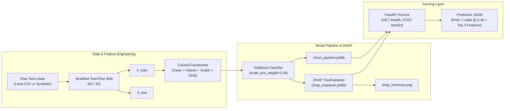

# Customer Churn Prediction Engine with FastAPI & Explainability

A production-ready machine learning service that predicts customer churn on the Telco Customer Churn dataset, optimizes for high recall at a calibrated decision threshold of 0.45, provides model explanations via SHAP TreeExplainer, and serves real-time predictions through FastAPI.

---

## Architecture Overview



---

## Key Features

1. **Leak-Free Preprocessing Pipeline**:
   - `ColumnTransformer` fitted strictly on training data post-split.
   - Robust `TotalChargesCleaner` handling whitespace, string coercion, and median imputation.
   - Standard scaling for continuous features (`tenure`, `MonthlyCharges`, `TotalCharges`).
   - Dense one-hot encoding with `handle_unknown='ignore'` for categorical features.

2. **Model Comparison & Benchmark**:
   - Baseline: `LogisticRegression(class_weight='balanced')`
   - Challenger: `XGBClassifier(scale_pos_weight=2.48)`
   - Winning Model: **XGBoost** achieving **0.9004 ROC-AUC** and **92.59% Recall** at decision threshold `0.45`.

3. **Explainable AI (SHAP)**:
   - Global feature importance beeswarm summary plot generated at `reports/figures/shap_summary.png`.
   - Real-time local JSON attribution extracting the top 3 driving features with direction (`"Increases churn risk"` vs `"Decreases churn risk"`).

4. **FastAPI Serving Layer**:
   - Pydantic v2 schemas validating customer input attributes and enumerations.
   - Startup model caching using FastAPI `lifespan` context manager.
   - Endpoints: `GET /health`, `POST /predict`, and auto-generated Swagger UI at `/docs`.

5. **Pytest Verification Suite**:
   - 14 automated unit and integration tests covering preprocessing, model serialization, probability bounds, and API contracts.

---

## Project Layout

```
customer_churn_engine/
├── config/
│   └── config.yaml              # Hyperparameters, paths, and feature configurations
├── artifacts/                   # Primary production artifact store
│   ├── models/
│   │   ├── churn_pipeline.joblib# Serialized Scikit-learn Pipeline
│   │   └── shap_explainer.joblib# Serialized SHAP TreeExplainer
│   ├── metrics/
│   │   └── metrics.json         # Benchmark comparison metrics
│   └── reports/
│       └── shap_summary.png     # Global SHAP beeswarm plot
├── models/                      # Backward-compatible model artifact mirror
├── data/
│   └── raw/
│       └── telco_customer_churn.csv # Raw/synthetic Telco dataset
├── reports/
│   └── figures/
│       └── shap_summary.png     # Legacy report figures location
├── src/
│   ├── core/                    # Core configuration and exception handling
│   │   ├── config.py            # Typed Settings and YAML loader
│   │   └── exceptions.py        # Domain-specific error hierarchies
│   ├── data/                    # Ingestion and dataset schemas
│   │   ├── dataset_schema.py    # Feature constants & tabular schema (no name clash)
│   │   ├── loader_factory.py    # DataLoaderFactory (Local, Remote, Synthetic)
│   │   ├── fetch_data.py        # Ingestion entrypoint using DataLoaderFactory
│   │   └── schema.py            # Backward-compatible schema bridge
│   ├── features/                # Leak-free preprocessing pipelines
│   │   └── preprocessor.py      # PreprocessorFactory & TotalChargesCleaner
│   ├── modeling/                # Machine learning models, pipelines, and SHAP
│   │   ├── factory.py           # ModelFactory & PipelineFactory
│   │   ├── train.py             # End-to-end training orchestrator
│   │   ├── evaluate.py          # Metrics computation
│   │   └── explain.py           # SHAP TreeExplainer integration
│   ├── models/                  # Backward-compatible shim delegating to src.modeling
│   ├── api/                     # Serving layer using Application Factory pattern
│   │   ├── app.py               # create_app() Application Factory
│   │   ├── main.py              # CLI & ASGI entrypoint
│   │   ├── routes.py            # Endpoints (/health, /predict)
│   │   ├── schemas.py           # CustomerPayload & API DTO schemas
│   │   └── service.py           # ModelManager & ModelServiceFactory
│   └── ui/                      # Dedicated presentation layer
│       └── dashboard.py         # Streamlit interactive dashboard
└── tests/
    ├── conftest.py              # Shared fixtures
    ├── test_api.py              # API contract integration tests
    ├── test_factories.py        # Unit tests for all Factory Method implementations
    ├── test_model.py            # Pipeline and explainability unit tests
    └── test_preprocessing.py    # Transformer & leakage tests
```

---

## Design Patterns: Factory Methods

This codebase strictly implements the **Factory Method** pattern across all key subsystems to decouple creation from execution:

1. **Application Factory (`src.api.app.create_app`)**:
   - Creates and configures FastAPI instances with configurable dependencies, lifecycles, and middleware.
   - Enables isolated test environments and production deployments without global state contamination.

2. **Model & Pipeline Factory (`src.modeling.factory.ModelFactory`, `PipelineFactory`)**:
   - `ModelFactory`: Dynamically registers and instantiates ML estimators (`xgboost`, `logistic_regression`, `random_forest`) with standardized hyperparameter defaults.
   - `PipelineFactory`: Assembles full end-to-end `Pipeline` objects combining `ColumnTransformer` feature transformers with chosen estimators.

3. **Preprocessor Factory (`src.features.preprocessor.PreprocessorFactory`)**:
   - Builds numerical cleaning/imputation/scaling sub-pipelines and categorical imputation/encoding sub-pipelines.
   - Assembles leak-free `ColumnTransformer` configurations.

4. **Data Loader Factory (`src.data.loader_factory.DataLoaderFactory`)**:
   - Provides concrete data loaders (`LocalCsvDataLoader`, `RemoteCsvDataLoader`, `SyntheticDataLoader`, and `AutoFallbackDataLoader`).

5. **Inference Service Factory (`src.api.service.ModelServiceFactory`)**:
   - Instantiates configured `ModelManager` services with custom artifact paths and calibrated decision thresholds.

---

## Getting Started

### 1. Prerequisites & Virtual Environment

```bash
uv venv .venv
source .venv/bin/activate
uv pip install -r requirements.txt
```

### 2. Train and Benchmark the Models

```bash
python -m src.modeling.train
```

Outputs:
- Serializes `artifacts/models/churn_pipeline.joblib` (and `models/churn_pipeline.joblib`)
- Serializes `artifacts/models/shap_explainer.joblib` (and `models/shap_explainer.joblib`)
- Generates `artifacts/metrics/metrics.json`
- Saves global summary plot `artifacts/reports/shap_summary.png`

### 3. Run the Test Suite

```bash
pytest -v
```

All 26 automated unit and integration tests will execute, covering factories, preprocessing, model serialization, probability bounds, and API contracts.

### 4. Start the FastAPI Service

```bash
uvicorn src.api.main:app --host 0.0.0.0 --port 8000 --reload
```

Interactive documentation is available at `http://localhost:8000/docs`.

### 5. Launch the Streamlit Dashboard

```bash
streamlit run src/ui/dashboard.py
```

---

## API Reference

### `GET /health`
Returns service status, model version, model type, and active threshold.

**Sample Response**:
```json
{
  "status": "healthy",
  "model_version": "1.0.0",
  "model_type": "XGBClassifier",
  "threshold": 0.45
}
```

### `POST /predict`
Submits a customer payload for churn risk evaluation and local SHAP feature explanations.

**Sample Request**:
```json
{
  "customerID": "7590-VHVEG",
  "gender": "Female",
  "SeniorCitizen": 0,
  "Partner": "No",
  "Dependents": "No",
  "tenure": 1,
  "PhoneService": "Yes",
  "MultipleLines": "No",
  "InternetService": "Fiber optic",
  "OnlineSecurity": "No",
  "OnlineBackup": "No",
  "DeviceProtection": "No",
  "TechSupport": "No",
  "StreamingTV": "Yes",
  "StreamingMovies": "Yes",
  "Contract": "Month-to-month",
  "PaperlessBilling": "Yes",
  "PaymentMethod": "Electronic check",
  "MonthlyCharges": 95.50,
  "TotalCharges": 95.50
}
```

**Sample Response**:
```json
{
  "customer_id": "7590-VHVEG",
  "churn_probability": 0.8124,
  "churn_prediction": 1,
  "threshold_used": 0.45,
  "top_driving_features": [
    {
      "feature": "Contract_Month-to-month",
      "attribution": 1.4521,
      "impact": "Increases churn risk"
    },
    {
      "feature": "InternetService_Fiber optic",
      "attribution": 0.6214,
      "impact": "Increases churn risk"
    },
    {
      "feature": "tenure",
      "attribution": 0.5103,
      "impact": "Increases churn risk"
    }
  ]
}
```
